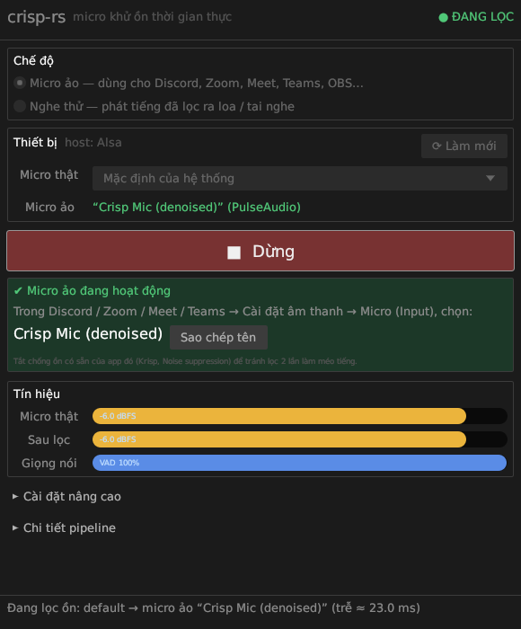

# crisp-rs

Real-time microphone noise suppression as a small CLI / daemon **and a desktop app**,
written in Rust.



* Captures a microphone with [`cpal`](https://crates.io/crates/cpal)
* Denoises with RNNoise via [`nnnoiseless`](https://crates.io/crates/nnnoiseless)
* Plays the clean signal to any output device (speakers or a virtual cable such as
  VB-Cable / BlackHole / PipeWire null sink) so it can be used as a "clean mic" in
  Discord, Zoom, OBS, ...
* Designed for **< 25 ms** mic-to-output latency with **no xruns**: lock-free SPSC ring
  buffers between the audio callbacks and a dedicated DSP thread, no allocation and
  no locks in the real-time callbacks.

## Pipeline

```
CPAL input cb            DSP worker thread                     CPAL output cb
(device rate, N ch)      (allocates nothing after start-up)    (device rate, M ch)
┌────────────────┐ SPSC  ┌───────────────────────────────┐ SPSC ┌──────────────────┐
│ downmix → mono │ ────► │ rubato  → 48 kHz              │ ───► │ mono → M ch      │
│ try_push       │ in_rb │ RNNoise 480-sample frames     │ out  │ try_pop          │
│ unpark(worker) │       │ rubato  → output device rate  │ _rb  │ silence on empty │
└────────────────┘       └───────────────────────────────┘      └──────────────────┘
```

* `src/resampler.rs` – streaming wrapper over `rubato::SincFixedIn` (pass-through
  when the device already runs at 48 kHz).
* `src/denoiser.rs` – wrapper over `nnnoiseless::DenoiseState`, gathers 480-sample
  frames and converts between ±1.0 floats and the i16 range RNNoise expects.
* `src/audio_engine.rs` – device selection, stream configuration, ring buffers,
  worker thread, latency clamp, graceful shutdown.
* `src/main.rs` – `clap` CLI (`crisp-rs`).
* `src/bin/gui.rs` – desktop GUI (`crisp-gui`, egui/eframe): device pickers, period /
  sample-rate / bypass settings, Start/Stop, live mic & output meters, VAD, latency
  budget and xrun counters. The UI thread only reads atomics; audio runs exactly the
  same engine as the CLI.

## Downloads

Prebuilt binaries for **Windows x86_64** and **Linux x86_64** are on the
[Releases page](https://github.com/otkhovps-sys/rustle-dsp/releases). Each archive
contains both `crisp-gui` (desktop app) and `crisp-rs` (CLI).

GitHub Actions (`.github/workflows/build.yml`) builds them on every push (see the run's
**Artifacts**) and publishes a Release when a `v*` tag is pushed. A macOS arm64 build
is available on demand via **Actions → build → Run workflow → macos**.

## Build

```bash
cargo build --release                       # CLI + GUI
cargo build --release --no-default-features # CLI only (no egui)
```

Linux needs the ALSA headers (`libasound2-dev` on Debian/Ubuntu, `alsa-lib-devel`
on Fedora); the GUI additionally needs an OpenGL-capable X11/Wayland session at run
time. macOS and Windows need nothing extra. Cross-compiling for Windows from Linux
works with `rustup target add x86_64-pc-windows-gnu` + `gcc-mingw-w64-x86-64`.

## Desktop app

```bash
crisp-gui
```

1. Pick the microphone and the output device (speakers to monitor, or a virtual
   cable such as VB-Cable / BlackHole / a PipeWire null sink to feed other apps).
2. Optionally change the period size (latency vs. robustness) or force a sample rate.
3. **Start**. The meters show input/output level, voice-activity probability, the
   estimated latency budget and the xrun counters. **Stop** (or closing the window)
   flushes the pipeline before exiting.

The GUI embeds DejaVu Sans so Vietnamese labels render correctly on every platform.

## Usage

```bash
# list devices (index + name, default marked with *)
crisp-rs list

# default mic → default speakers
crisp-rs run

# pick devices by index or (case-insensitive) name substring
crisp-rs run --input "USB Mic" --output "CABLE Input"

# A/B the denoiser without changing latency
crisp-rs run --bypass

# force a device rate to exercise the resampler path
crisp-rs run --rate 44100

# smaller period for lower latency (if the backend accepts it)
crisp-rs run --buffer-frames 64
```

`Ctrl+C` (or `SIGTERM`) stops capture, flushes the resamplers and the last partial
RNNoise frame, lets the output queue drain, and exits. A second `Ctrl+C` exits
immediately.

## Latency budget

Printed at start-up, e.g. for a 48 kHz device with 128-frame periods:

```
input period + RNNoise framing :  10.00 ms  (max of 2.67 ms, 10.00 ms)
resampler in  (48000 -> 48000)  :   0.00 ms
resampler out (48000 -> 48000)  :   0.00 ms
output queue (priming level)    :   7.67 ms  (368 frames)
output period                   :   2.67 ms
≈ total                         :  20.33 ms
```

Where the numbers come from:

* **RNNoise frame** – 480 samples = 10 ms; a sample can wait up to one frame before
  the network runs. This dominates and cannot be reduced.
* **Device period** – `--buffer-frames` (default 128 = 2.67 ms @ 48 kHz) per direction.
* **Output priming** – the output stays silent until `period + 240` frames are queued.
  That half-frame margin absorbs worker scheduling jitter so the 10 ms bursts of
  RNNoise output never starve the output callback.
* **Resampler** – only when a device cannot run at 48 kHz: sinc group delay
  (32 frames) + chunk gathering (64 frames) ≈ 2 ms per direction. With both ends
  at 44.1 kHz the printed worst case is ≈ 24.5 ms (the average sample sees ~5 ms less,
  since RNNoise framing is 0–10 ms depending on position in the frame).

### Run-time safeguards

* **Latency clamp** – clock drift between two devices (or a long scheduler stall)
  would otherwise make the queues grow forever. When the input backlog exceeds ~40 ms,
  or the output queue exceeds the priming level by two frames, the oldest input is
  dropped (one small click, bounded latency, counted in `dropped`).
* **Underrun handling** – the output callback emits silence and re-primes, so a single
  stall produces one gap instead of continuous crackling.
* `--stats-secs N` logs frames processed, VAD probability, queue depths and all
  overrun/underrun/drop counters.

## Tuning tips

* Prefer a 48 kHz device configuration for both ends: it removes both resamplers.
* On Linux, PipeWire users can lower the quantum (`PIPEWIRE_LATENCY=128/48000`) for
  the ALSA plugin, or run with the JACK backend.
* If you see `out_underrun` counts growing, raise `--buffer-frames` (256) or pin the
  process to a core / give it real-time priority (`chrt -f 10 crisp-rs run ...`).
